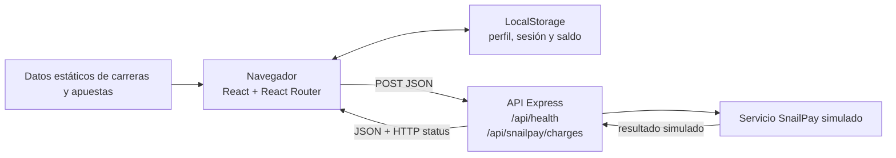
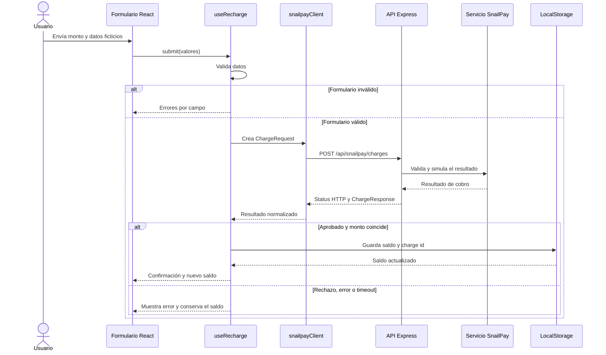
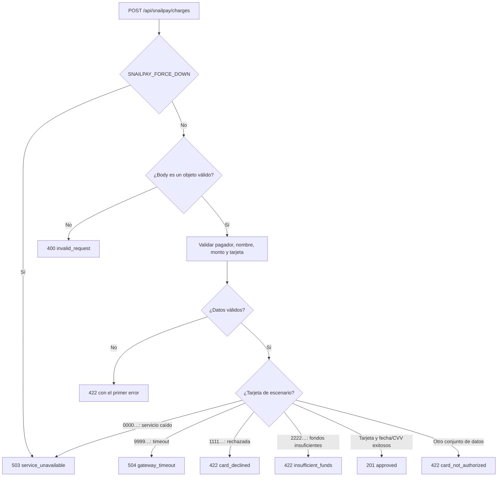

# Arquitectura y diagramas

## Vista general

El repositorio es un monorepo npm con dos aplicaciones TypeScript independientes. Vite sirve el frontend React durante el desarrollo y el backend Express expone la API local de SnailPay. El frontend consume esa API únicamente para simular recargas; el registro, el inicio de sesión, el saldo y los datos de dashboard no se guardan en el backend.

## Flujo de una recarga

El cliente valida el formulario antes de realizar la llamada. Solo acredita el saldo si la respuesta cumple el contrato de aprobación y su monto coincide con el solicitado. Los identificadores de cobro ya aplicados se conservan para evitar volver a acreditar la misma respuesta.

## Decisión de SnailPay

La API valida primero la disponibilidad global configurada, el cuerpo JSON y los campos requeridos. Después evalúa las tarjetas de escenario en orden: servicio no disponible, timeout, rechazo, fondos insuficientes, aprobación de prueba y, por defecto, tarjeta no autorizada. La primera condición aplicable determina el resultado.

## Límites y persistencia

- No hay base de datos ni API de autenticación: el navegador conserva cuenta, sesión y saldo.
- Las estadísticas del dashboard se calculan a partir del fixture local `simulatedDay`.
- Solo la operación de cobro se comunica con el backend.
- SnailPay es un simulador para datos de prueba, no una integración con una entidad financiera.
